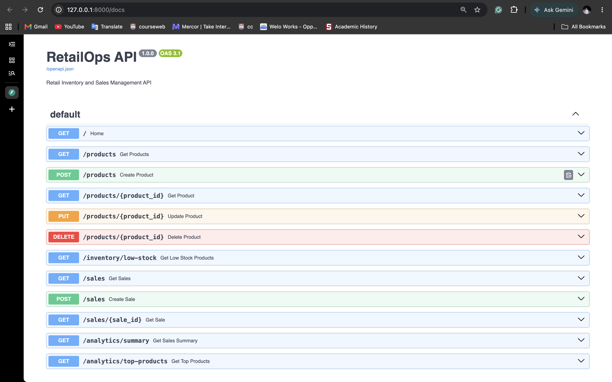
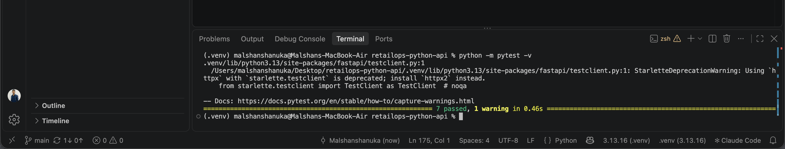

# RetailOps API

A Python REST API for managing retail products, inventory, sales, and business analytics.

Built with FastAPI, SQLAlchemy, and SQLite as a backend development portfolio project.

## Features

- Product management with CRUD operations
- Inventory tracking and low-stock detection
- Sales recording with automatic stock reduction
- Insufficient-stock validation
- Sales revenue and quantity summaries
- Top-selling product analytics
- Interactive Swagger API documentation
- Automated API tests using Pytest

## Screenshots

### Swagger API Documentation



### Pytest Results

Seven automated tests passed successfully.



## Tech Stack

- Python 3.13
- FastAPI
- SQLAlchemy
- SQLite
- Pydantic
- Pytest
- Git and GitHub

## Project Structure

```text
retailops-python-api/
├── app/
│   ├── __init__.py
│   ├── main.py
│   ├── database.py
│   ├── models.py
│   └── schemas.py
├── tests/
│   └── test_products.py
├── screenshots/
│   ├── swagger-ui.png
│   └── pytest-results.png
├── requirements.txt
├── .gitignore
└── README.md
```

## Installation and Setup

### 1. Clone the repository

```bash
git clone https://github.com/Malshanshanuka/retailops-python-api.git
cd retailops-python-api
```

### 2. Create a virtual environment

```bash
python3.13 -m venv .venv
source .venv/bin/activate
```

### 3. Install dependencies

```bash
python -m pip install -r requirements.txt
```

### 4. Run the application

```bash
python -m uvicorn app.main:app --reload
```

API: http://127.0.0.1:8000

Swagger UI: http://127.0.0.1:8000/docs

## API Endpoints

| Method | Endpoint | Description |
|--------|----------|-------------|
| GET | / | API status |
| POST | /products | Create product |
| GET | /products | List products |
| GET | /products/{product_id} | Get product |
| PUT | /products/{product_id} | Update product |
| DELETE | /products/{product_id} | Delete product |
| GET | /inventory/low-stock | Get low-stock products |
| POST | /sales | Record sale |
| GET | /sales | List sales |
| GET | /sales/{sale_id} | Retrieve a sale |
| GET | /analytics/summary | Sales summary |
| GET | /analytics/top-products | Top-selling products |

## Example API Request

POST /products

```json
{
  "name": "Dell Laptop",
  "category": "Electronics",
  "price": "250000.00",
  "quantity": 10,
  "low_stock_threshold": 3
}
```

A successful request returns HTTP 201 Created.

## Sales and Inventory Logic

When recording a sale, the application validates the product and requested quantity, calculates the total amount, and saves the sale while reducing the available stock in one database transaction.

If stock is insufficient, the API rejects the request without recording the sale.

## Automated Testing

The project uses Pytest and FastAPI TestClient with a separate temporary SQLite test database.

Run all tests:

```bash
python -m pytest -v
```

Seven tests cover product creation, product retrieval, invalid prices, missing products, successful sales, insufficient stock, and analytics response structure.

Latest local result: 7 passed, 1 dependency deprecation warning.

## Current Limitations

This is a learning and portfolio application. Authentication, concurrency-safe stock management, and production deployment are not implemented.

## Future Improvements

- JWT authentication and role-based access
- PostgreSQL support
- Docker containerization
- CI/CD using GitHub Actions
- Improved concurrent sales handling
- Additional API integration tests

## Author

**Malshan Shanuka**

BSc (Hons) Information Technology, SLIIT

GitHub: https://github.com/Malshanshanuka
  
